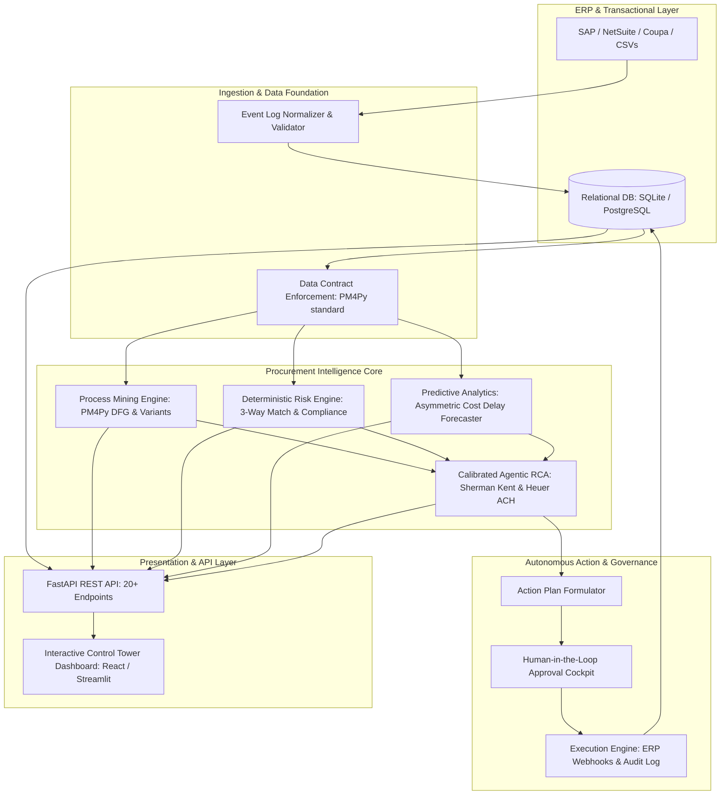

# 🏛️ NEXUS Control Tower — System Architecture Specification

> **NEXUS Procure-to-Pay (P2P) Intelligence Platform**  
> *End-to-End Technical, Data Engineering, Machine Learning, and Agentic Execution Architecture*

---

## 1. High-Level Architecture Overview

NEXUS is designed as a decoupled, microservice-ready system engineered for low-latency operational process intelligence, strict data contracts, and enterprise auditability.

---

## 2. Component Architecture Breakdown

### 2.1 Database & Persistence Layer (`backend/database.py`, `backend/models.py`)
* **ORM:** SQLAlchemy with SQLite for deterministic local development, seamlessly upgradeable to PostgreSQL/Azure SQL.
* **11 Enterprise Normalized Relational Models:**
  1. `Suppliers`: Master vendor registry with tiering, lead times, and reliability scoring.
  2. `Products`: SKU catalog with category, unit cost, and standard delivery lead times.
  3. `Employees`: Org hierarchy, buyer roles, department affiliations, and approval limits.
  4. `PurchaseRequisitions`: Requisition tracking with department tagging and budget status.
  5. `PurchaseOrders`: Contracted orders with total amount, order date, promised delivery, and risk status.
  6. `PurchaseOrderItems`: Granular line-item breakdown with quantity, unit price, and total.
  7. `GoodsReceipts`: Warehouse receiving receipts with received quantity, condition, and actual delivery date.
  8. `Invoices`: Supplier billing details, due dates, payment terms, and status.
  9. `Payments`: Disbursement records with payment date, method, reference, and cash discount flags.
  10. `ProcessEvents`: The chronological process mining event log (`case_id`, `activity`, `timestamp`, `resource_id`).
  11. `RiskAssessments`: Historical log of calculated risk scores, flags, and mitigation statuses.

### 2.2 Process Intelligence Core (`process_intelligence/`, `backend/services/process_intelligence.py`)
* **Process Mining (PM4Py):** Computes Directly-Follows Graphs (DFG), identifies common and deviant execution variants, and measures transition durations between P2P stages.
* **Bottleneck Telemetry:** Percentile duration analysis (P50, P90, P99) across stage transitions:
  - `Purchase Requisition Created` $\to$ `Purchase Requisition Approved`
  - `Purchase Requisition Approved` $\to$ `Purchase Order Created`
  - `Purchase Order Created` $\to$ `Goods Receipt`
  - `Goods Receipt` $\to$ `Invoice Received`
  - `Invoice Received` $\to$ `Payment`
* **Conformance Checking:** Detects skips (e.g. PO placed before Requisition Approval) and unauthorized loops.

### 2.3 Deterministic Compliance & Risk Engine (`backend/services/procurement_engine.py`)
* Fast, explainable rule-based scoring (0–100 scale):
  - **Maverick / Approval Bypass:** PO created without approved requisition or amount exceeding employee authorization threshold.
  - **Split PO Detection:** Multiple POs issued to the same supplier within 72 hours, each under the threshold, summing over it.
  - **3-Way Match Validation:** Comparing PO Quantity/Price against Goods Receipt Quantity and Invoice Billed Amount.
  - **Supplier Reliability Factor:** Historical on-time delivery rate incorporated into immediate order scoring.

### 2.4 Predictive Analytics Engine (`backend/services/`)
* **Cost-Sensitive Delay Forecasting:**
  - Addresses the **asymmetric error cost** in enterprise supply chains (missing a high-impact delay costs 10x–50x more than reviewing a false alarm).
  - Multi-horizon checkpoints (predicting delivery risk at PO creation, after supplier confirmation, and 5 days prior to promised date).

### 2.5 Calibrated Agentic RCA & Action Planner (`backend/services/root_cause.py`, `backend/services/ai_service.py`)
* **Calibrated Reasoning Protocol (Sherman Kent):** LLM risk summaries are constrained by deterministic estimative probability intervals, avoiding arbitrary or ungrounded assertions.
* **Richards Heuer Analysis of Competing Hypotheses (ACH):** Simultaneously tests competing explanations for delay or deviation:
  - *Hypothesis 1:* Supplier production/capacity bottleneck.
  - *Hypothesis 2:* Internal managerial sign-off friction.
  - *Hypothesis 3:* Carrier logistics or customs congestion.
* **Azure OpenAI Service:** Enterprise GPT-4o integration with automated fallback to mock testing provider for continuous integration.

### 2.6 Governance & Execution Engine (`backend/services/approval_service.py`, `backend/services/execution_service.py`)
* **Human-in-the-Loop (HITL) Workflows:** High-risk interventions (e.g., cancelling an order, re-routing to an alternative supplier, holding payment on an invoice) require authorized operator sign-off.
* **Audit Service:** Immutable append-only logging of every automated or manual decision, preserving an audit trail for SOX/compliance reviews.

---

## 3. API Contract & Endpoint Surface (`backend/routes.py`)

The FastAPI backend exposes 20+ documented REST endpoints across 6 functional controllers:

| Controller | Endpoints | Purpose |
| :--- | :--- | :--- |
| **Procurement Master** | `/api/suppliers`, `/api/products`, `/api/orders`, `/api/invoices`, `/api/payments` | CRUD and retrieval of master entity records. |
| **Process Mining** | `/api/process/events`, `/api/process/variants`, `/api/process/dfg`, `/api/process/cycle-times` | Event log queries, graph generation, and transition latency metrics. |
| **Risk & Compliance** | `/api/risk/evaluate/{order_id}`, `/api/risk/summary`, `/api/risk/three-way-match` | Real-time order risk evaluation and compliance anomaly reports. |
| **AI Root Cause** | `/api/ai/root-cause/{order_id}`, `/api/ai/narrative` | Calibrated LLM root-cause synthesis and competing hypothesis evaluation. |
| **Action Planning** | `/api/actions/propose/{order_id}`, `/api/actions/plans` | Prescriptive mitigation plan formulation and options matrix. |
| **HITL Governance** | `/api/actions/{plan_id}/approve`, `/api/actions/{plan_id}/reject`, `/api/audit/logs` | Stakeholder review, execution triggering, and tamper-evident audit history. |

---

## 4. Security, Concurrency, and Scalability

* **Stateless API Services:** FastAPI layer runs statelessly, enabling horizontal scale across containers (Docker / Kubernetes).
* **Idempotent Execution:** All execution actions (PO cancellations, invoice holds) utilize unique execution tokens to prevent duplicate requests.
* **Zero Data Leakage:** Event log extraction respects chronological timestamps to ensure retrospective validation without lookahead bias.
