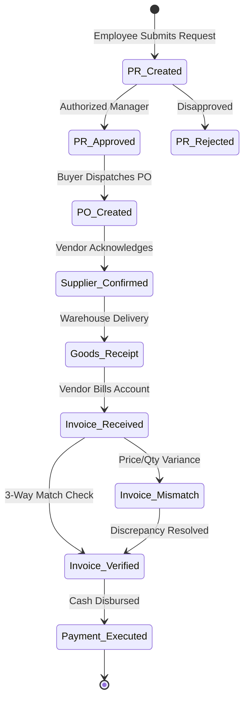

# 🔬 NEXUS Process Intelligence Specification

> **NEXUS Procure-to-Pay (P2P) Control Tower**  
> *Algorithmic Specification: Process Mining, Cycle Time Telemetry, Conformance Checking, and Anomaly Detection*

---

## 1. Process Mining Foundation (`PM4Py`)

NEXUS leverages formal process mining algorithms to reconstruct actual enterprise execution pathways from raw transaction event logs.

### 1.1 The Mandatory Process Mining Quadruple
Every event extracted from ERP transaction tables maps to the IEEE XES standard / PM4Py quadruple:
$$\mathcal{E} = \langle \text{case\_id}, \text{activity}, \text{timestamp}, \text{resource\_id} \rangle$$

* **`case_id`**: The persistent transaction journey (e.g., `CASE-00001` or `PO-00001`).
* **`activity`**: Standardized lifecycle verb (e.g., `Purchase Requisition Created`, `Purchase Order Created`, `Goods Receipt`).
* **`timestamp`**: ISO-8601 UTC chronological point of occurrence.
* **`resource_id`**: Employee, supplier, or automated system executing the step.

---

## 2. P2P Event Lifecycle & Graph Topologies

### 2.1 The Standard "Happy Path" Variant
1. `Purchase Requisition Created`
2. `Purchase Requisition Approved`
3. `Purchase Order Created`
4. `Supplier Confirmation`
5. `Goods Receipt`
6. `Invoice Received`
7. `Invoice Verification`
8. `Payment`

### 2.2 Process Deviations & Anomalous Variants
* **Maverick Buying Variant:** `Purchase Order Created` occurs **prior** to `Purchase Requisition Approved` (retroactive approval).
* **Delivery-Before-PO:** `Goods Receipt` precedes `Purchase Order Created` (uncontracted rush order).
* **Payment-Before-Verification:** `Payment` occurs without a preceding `Invoice Verification` or `Goods Receipt` (uncontrolled cash risk).
* **Endless Approval Loop:** Multiple consecutive `Purchase Requisition Approved` events on the same case.

---

## 3. Cycle Time & Telemetry Metrics

NEXUS computes transition durations $\Delta t$ between consecutive activities for each case $c$:
$$\Delta t_{i, j}^{(c)} = t(e_{j}^{(c)}) - t(e_{i}^{(c)})$$

### 3.1 Percentile Latency Profiling
For every transition pair $(A_i, A_j)$, NEXUS tracks three operational percentiles across the cohort:
* **P50 (Median Duration):** Baseline operational expectation under nominal conditions.
* **P90 (SLA Warning Threshold):** Statistical inflection point where operational delays begin impacting downstream milestones.
* **P99 (Critical Bottleneck):** Outlier territory indicating frozen requisitions, disputed shipments, or operational breakdown.

### 3.2 Stage Transition Definitions

| Transition ID | From Activity | To Activity | Target P50 | Target P90 | Primary Failure Driver |
| :--- | :--- | :--- | :--- | :--- | :--- |
| **`T1_APPROVAL`** | Requisition Created | Requisition Approved | 24 Hours | 48 Hours | Manager availability, threshold routing |
| **`T2_PO_DISPATCH`** | Requisition Approved | PO Created | 8 Hours | 24 Hours | Procurement backlog, supplier setup |
| **`T3_CONFIRM`** | PO Created | Supplier Confirmation | 24 Hours | 72 Hours | Supplier EDI integration, stock check |
| **`T4_FULFILLMENT`** | Supplier Confirmation | Goods Receipt | Lead Time | Lead Time + 3d | Production capacity, freight delays |
| **`T5_MATCHING`** | Invoice Received | Invoice Verified | 12 Hours | 36 Hours | Quantity/price variance, missing GR |
| **`T6_DISBURSEMENT`** | Invoice Verified | Payment | Net Terms | Net Terms - 2d | Treasury payment batching, cash flow |

---

## 4. Anomaly Detection & Risk Formulas

NEXUS synthesizes a composite risk score $R \in [0, 100]$ for every in-flight case combining four orthogonal risk dimensions:

$$R_{\text{composite}} = w_1 R_{\text{compliance}} + w_2 R_{\text{lead\_time}} + w_3 R_{\text{matching}} + w_4 R_{\text{supplier\_drift}}$$

### 4.1 Dimension Weights
* $w_1 = 0.30$ (Compliance & Approval Violations)
* $w_2 = 0.25$ (Predicted Delivery Delay)
* $w_3 = 0.25$ (3-Way Matching Discrepancies)
* $w_4 = 0.20$ (Supplier Historical Reliability Degradation)

### 4.2 Mathematical Risk Definitions

#### A. 3-Way Match Discrepancy Score ($R_{\text{matching}}$)
Let $Q_{\text{PO}}$ be ordered quantity, $P_{\text{PO}}$ contracted unit price, $Q_{\text{GR}}$ accepted quantity, and $P_{\text{INV}}, Q_{\text{INV}}$ invoiced metrics:
$$\delta_Q = \frac{|Q_{\text{INV}} - Q_{\text{GR}}|}{Q_{\text{PO}}}, \quad \delta_P = \frac{|P_{\text{INV}} - P_{\text{PO}}|}{P_{\text{PO}}}$$
$$R_{\text{matching}} = \min\left(100, \; 100 \times (\delta_Q + 1.5 \cdot \delta_P)\right)$$

#### B. Asymmetric Cost-Sensitive Delay Prediction ($R_{\text{lead\_time}}$)
Standard classification error treats False Positives and False Negatives equally. In enterprise procurement, missing a critical line-stopping delay incurs vastly higher cost than auditing an order that arrives on time.
$$\text{Expected Loss} = C_{\text{FN}} \cdot P(\text{Delay} \mid \mathbf{x}) \cdot (1 - \hat{y}) + C_{\text{FP}} \cdot (1 - P(\text{Delay} \mid \mathbf{x})) \cdot \hat{y}$$
Where $\frac{C_{\text{FN}}}{C_{\text{FP}}} \approx 10$ to $25$. The decision boundary threshold $\tau^*$ is calibrated to:
$$\tau^* = \frac{C_{\text{FP}}}{C_{\text{FP}} + C_{\text{FN}}}$$

---

## 5. Calibrated Root Cause Analysis (RCA) Protocol

When a case breaches $R_{\text{composite}} \ge 60$, NEXUS dispatches the **Calibrated RCA Agent**:

1. **Evidence Collection:** The agent pulls historical supplier on-time rate, current transition cycle times, open 3-way discrepancies, and seasonal load.
2. **Analysis of Competing Hypotheses (Richards Heuer ACH):**
   * *Hypothesis $H_1$: Supplier Capacity Saturation*
   * *Hypothesis $H_2$: Internal Procurement Queue Congestion*
   * *Hypothesis $H_3$: Logistics Carrier Disruption*
3. **Calibrated Estimative Probability (Sherman Kent):**
   * Outputs must explicitly state CIA-standard confidence brackets:
     - **Almost Certain (90–99%)**: Proven by multiple corroborating data points.
     - **Probable (60–80%)**: Supported by primary evidence with minor unknowns.
     - **Roughly Even Chance (40–60%)**: Inconclusive data; warrants human inspection.
     - **Unlikely (10–30%)**: Contradicted by event log evidence.
